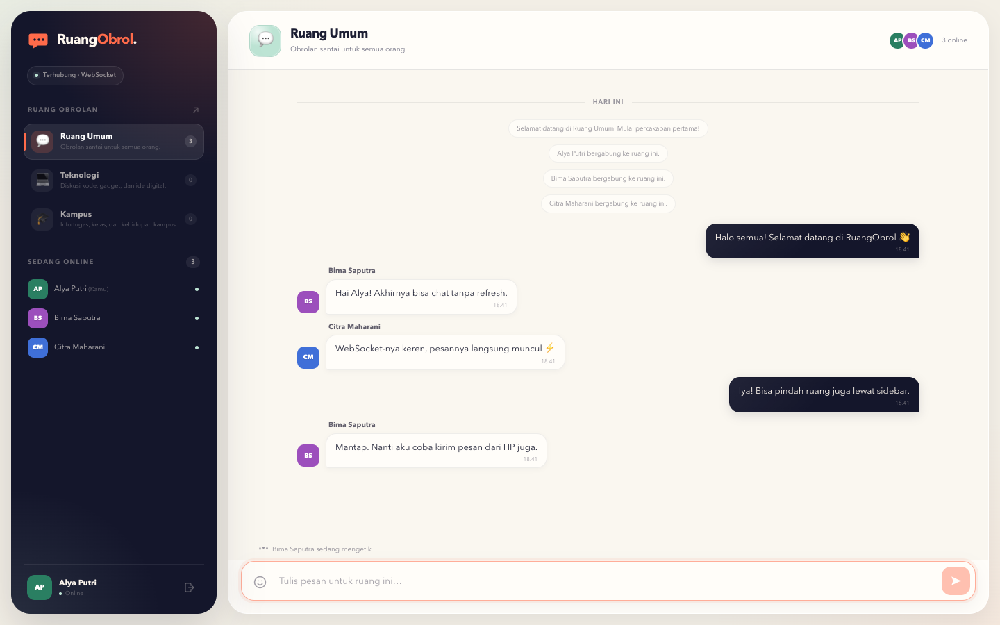

# RuangObrol — Chat Real-Time Berbasis WebSocket

Aplikasi chat multi-client yang menerapkan komunikasi socket antara browser (client) dan server Node.js. Pesan, daftar pengguna online, indikator mengetik, dan perpindahan ruang dikirim secara **real-time melalui WebSocket** menggunakan Socket.IO.

Proyek ini dibuat untuk tugas **Pemrograman Socket** dengan tema **Aplikasi Chat Real-Time**.



## Fitur

- **Chat real-time** — pesan muncul tanpa refresh melalui koneksi WebSocket yang persisten.
- **Multi-client & multi-room** — tiga ruang bawaan: Ruang Umum, Teknologi, dan Kampus.
- **Presence** — daftar pengguna online dan jumlah anggota per ruang diperbarui otomatis.
- **Indikator mengetik** — muncul saat pengguna lain sedang menulis.
- **Riwayat sementara** — maksimal 80 pesan terakhir per ruang disimpan di memori server.
- **Validasi server** — nama 2–24 karakter, nama unik per ruang, pesan 1–500 karakter, dan perlindungan dari pengiriman beruntun.
- **Pindah ruang tanpa reload** — riwayat ruang tujuan langsung dimuat.
- **Responsif** — sidebar dapat dibuka sebagai drawer pada layar mobile.
- **Status koneksi** — banner dan status WebSocket saat koneksi terputus.
- **UI aksesibel** — navigasi keyboard, label ARIA, fokus terlihat, dan `prefers-reduced-motion`.

## Teknologi

| Bagian | Teknologi |
| --- | --- |
| Server | Node.js, Express, Socket.IO (`socket.io@4`) |
| Client | HTML, CSS, JavaScript, Socket.IO Client |
| Protokol | WebSocket (full-duplex di atas TCP), HTTP untuk aset statis |
| Pengujian | Node.js Test Runner, Socket.IO Client, Playwright Core |
| Tangkapan layar | Playwright Core + Google Chrome |

## Menjalankan Aplikasi

Prasyarat: **Node.js 20+** dan npm.

```bash
npm install
npm start
```

Buka [http://localhost:3000](http://localhost:3000), lalu buka tab/jendela kedua (atau perangkat lain di jaringan yang sama) untuk mencoba percakapan multi-client.

Port dapat diubah melalui environment variable:

```bash
PORT=8080 npm start
```

Mode pengembangan dengan reload otomatis:

```bash
npm run dev
```

## Cara Menguji

### Pengujian otomatis

```bash
npm test
```

Enam pengujian integrasi memeriksa HTTP/static, komunikasi dua client lewat WebSocket, isolasi antarruang, validasi input, indikator mengetik, presence, dan perpindahan ruang.

### Pemeriksaan UI + tangkapan layar

```bash
npm run screenshots
```

Script ini membuka tiga client di Chrome headless, mengirim pesan, memeriksa indikator mengetik, menu mobile, dan perpindahan ruang, lalu menyimpan tangkapan layar ke `docs/screenshots/`. Secara default script mencari Google Chrome di macOS; gunakan `CHROME_PATH` bila browser berada di lokasi lain.

### Uji manual singkat

1. Jalankan server dan buka aplikasi di dua tab.
2. Masuk dengan nama berbeda pada ruang yang sama.
3. Kirim pesan dari tab pertama — pesan harus muncul di kedua tab tanpa refresh.
4. Ketik di salah satu tab — tab lain menampilkan indikator mengetik.
5. Pilih ruang **Teknologi** di sidebar — header dan riwayat ruang berganti.
6. Tutup salah satu tab — daftar online dan pesan sistem ikut diperbarui.

## Naskah Presentasi

Tersedia dalam tiga format:

- **[docs/NASKAH-PRESENTASI.docx](docs/NASKAH-PRESENTASI.docx)** — versi Word siap cetak (sampul, peta waktu, naskah, lampiran, nomor halaman).
- **[docs/NASKAH-PRESENTASI.txt](docs/NASKAH-PRESENTASI.txt)** — teks murni untuk dibaca saat latihan.
- **[docs/NASKAH-PRESENTASI.md](docs/NASKAH-PRESENTASI.md)** — versi Markdown.

Untuk membuat ulang file DOCX setelah naskah diubah:

```bash
npm run docx
```

Script `scripts/make-docx.js` menghasilkan `docs/NASKAH-PRESENTASI.docx`. Isi naskah pada script tersebut perlu disesuaikan bila versi `.txt` diubah.

## Struktur Proyek

```text
SPDT/
├── server.js                  # Express + HTTP + Socket.IO, state, validasi, event
├── public/
│   ├── index.html             # Halaman login dan antarmuka chat
│   ├── styles.css             # Tampilan responsif dan animasi
│   └── app.js                 # Client Socket.IO, render pesan, presence, UI
├── test/
│   └── chat.test.js           # 6 pengujian integrasi
├── scripts/
│   ├── make-docx.js           # Generator naskah presentasi DOCX
│   └── screenshots.js         # Pemeriksaan UI end-to-end + screenshot
├── docs/
│   ├── LAPORAN.md             # Laporan lengkap tugas
│   ├── NASKAH-PRESENTASI.md   # Naskah presentasi 3–5 menit (Markdown)
│   ├── NASKAH-PRESENTASI.txt  # Naskah presentasi (teks murni)
│   ├── NASKAH-PRESENTASI.docx # Naskah presentasi (Word)
│   ├── hasil-pengujian.txt    # Output pengujian
│   └── screenshots/           # Tangkapan layar aplikasi
├── package.json
└── README.md
```

## Alur Komunikasi Singkat

```text
Browser A ── HTTP GET / ───────────────► Express
Browser A ── WebSocket upgrade ───────► Socket.IO
Browser A ── session:join (ack) ──────► Server
Browser A ── chat:message (ack) ──────► Server
Server    ── chat:message ────────────► Semua client di ruang yang sama
Server    ── presence:update ─────────► Semua client di ruang
Server    ── typing:update ───────────► Semua client di ruang
```

Event lengkap, rancangan arsitektur, potongan kode utama, hasil pengujian, dan analisis tersedia di **[docs/LAPORAN.md](docs/LAPORAN.md)**. Naskah presentasi 3–5 menit tersedia dalam format **[DOCX](docs/NASKAH-PRESENTASI.docx)**, **[TXT](docs/NASKAH-PRESENTASI.txt)**, dan **[Markdown](docs/NASKAH-PRESENTASI.md)**.

## Batasan

- Pesan disimpan di memori dan hilang saat server dimulai ulang (belum memakai database).
- Belum ada autentikasi akun; nama hanya unik di dalam satu ruang.
- Aplikasi demo berjalan di HTTP/WS lokal. Untuk produksi gunakan HTTPS/WSS, autentikasi, penyimpanan permanen, dan moderasi.
- Client dikonfigurasi khusus WebSocket (`transports: ['websocket']`) agar sesuai fokus tugas; Socket.IO sebenarnya juga mendukung fallback polling.

## Referensi

- [MDN — WebSocket API](https://developer.mozilla.org/en-US/docs/Web/API/WebSockets_API)
- [Socket.IO — Rooms](https://socket.io/docs/v4/rooms/)
- [Socket.IO — Server API](https://socket.io/docs/v4/server-api/)
- [RFC 6455 — The WebSocket Protocol](https://www.rfc-editor.org/rfc/rfc6455)
