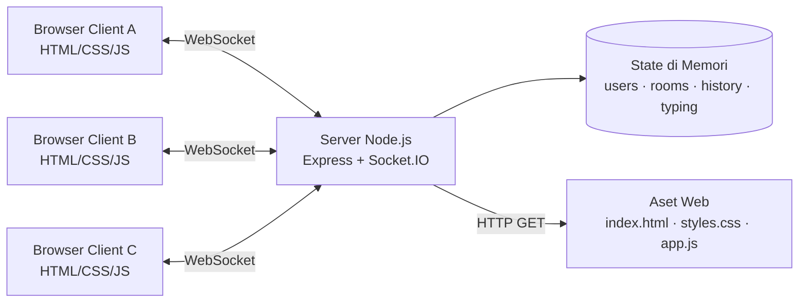
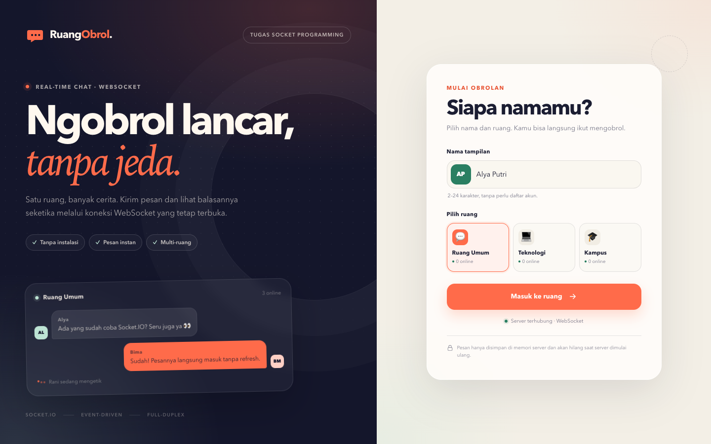
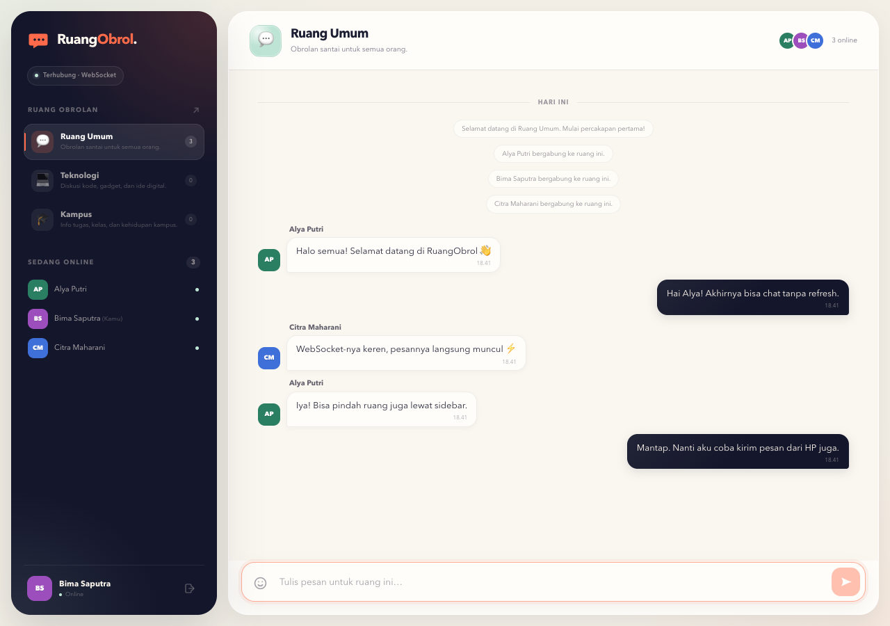
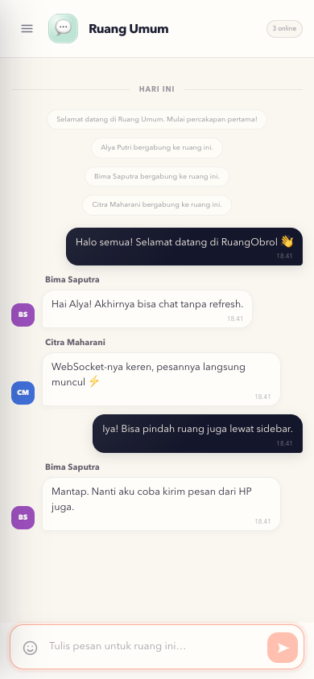
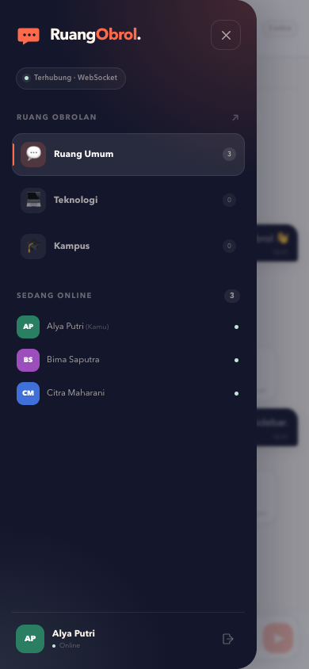
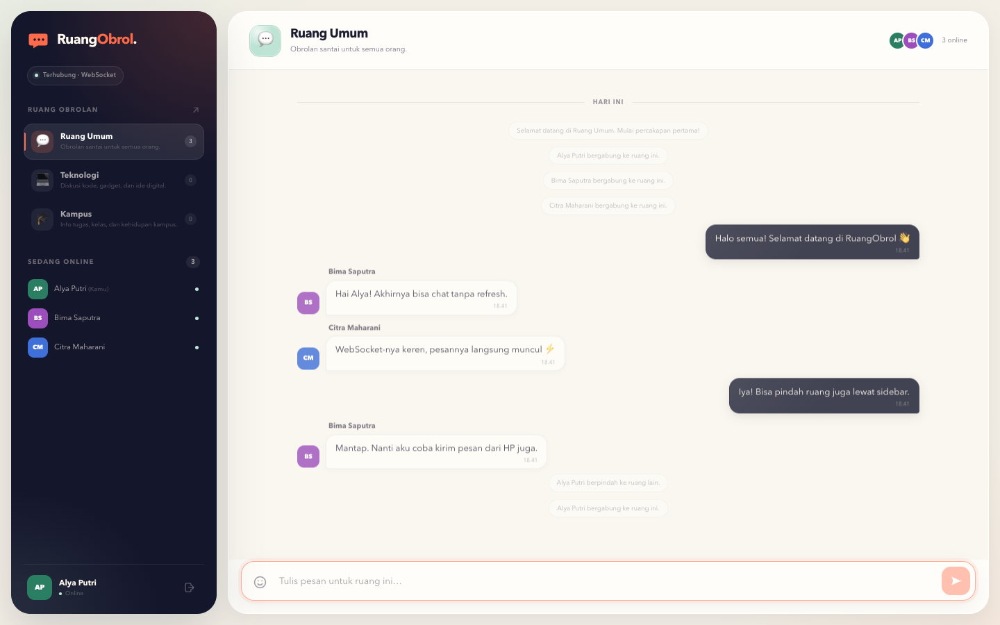

# LAPORAN TUGAS PEMROGRAMAN SOCKET

## Aplikasi Chat Real-Time “RuangObrol” Berbasis WebSocket dan Socket.IO

| Keterangan | Isi |
| --- | --- |
| Nama Mahasiswa | ................................................ |
| NIM | ................................................ |
| Mata Kuliah | Pemrograman Socket / Pemrograman Jaringan |
| Dosen Pengampu | ................................................ |
| Tanggal | 24 Oktober 2026 |

---

## Abstrak

RuangObrol adalah aplikasi chat berbasis web yang menerapkan komunikasi socket antara client dan server. Aplikasi memungkinkan beberapa pengguna bertukar pesan secara langsung di dalam ruang obrolan tanpa melakukan refresh halaman. Komunikasi data menggunakan WebSocket melalui library Socket.IO, sedangkan antarmuka dibangun dengan HTML, CSS, dan JavaScript. Server Node.js menyimpan daftar pengguna, riwayat pesan sementara, serta status mengetik di memori. Hasil pengujian menunjukkan bahwa pesan dapat dikirim dan diterima oleh beberapa client secara real-time, pesan tidak bocor ke ruang lain, validasi input berjalan, dan indikator kehadiran serta mengetik diperbarui otomatis. Seluruh enam pengujian integrasi berhasil (*pass*).

**Kata kunci:** socket, WebSocket, Socket.IO, chat real-time, TCP, client-server.

---

## Daftar Isi

1. [Pendahuluan](#1-pendahuluan)
2. [Landasan Teori](#2-landasan-teori)
3. [Rancangan Sistem](#3-rancangan-sistem)
4. [Implementasi](#4-implementasi)
5. [Pengujian dan Hasil](#5-pengujian-dan-hasil)
6. [Analisis](#6-analisis)
7. [Kesimpulan dan Saran](#7-kesimpulan-dan-saran)
8. [Referensi](#8-referensi)
9. [Lampiran](#9-lampiran)

---

## 1. Pendahuluan

### 1.1 Latar Belakang

Aplikasi chat membutuhkan pertukaran data dua arah dengan jeda yang sangat kecil. Pola HTTP request-response biasa kurang efisien untuk kebutuhan tersebut karena client harus terus-menerus bertanya kepada server apakah ada pesan baru (*polling*). WebSocket menawarkan koneksi persisten yang memungkinkan server mengirim data kepada client kapan saja tanpa menunggu permintaan baru. Dengan demikian, pesan dapat diterima seketika dan sumber daya koneksi lebih efisien.

Tugas ini meminta implementasi komunikasi client-server menggunakan socket yang dilengkapi antarmuka web. Tema yang dipilih adalah **Aplikasi Chat Real-Time** dengan teknologi HTML, CSS, JavaScript, Node.js, dan Socket.IO.

### 1.2 Tujuan

1. Memahami konsep komunikasi socket pada jaringan komputer.
2. Mengimplementasikan komunikasi antara client dan server.
3. Memahami penggunaan protokol TCP atau WebSocket.
4. Membuat antarmuka web untuk mengirim dan menerima data.
5. Melakukan pengujian komunikasi serta menganalisis hasilnya.

### 1.3 Tema dan Batasan

Tema yang dipilih adalah **aplikasi chat real-time multi-client dan multi-room**. Batasan implementasi:

- Pesan disimpan di memori server, bukan database.
- Nama pengguna unik di dalam satu ruang, tetapi belum ada autentikasi akun.
- Riwayat disimpan maksimal 80 pesan terakhir per ruang.
- Client dikonfigurasi menggunakan transport WebSocket secara eksplisit.
- Pesan teks maksimal 500 karakter; nama 2–24 karakter.
- Aplikasi dijalankan secara lokal melalui HTTP dan WebSocket (`ws://`).

---

## 2. Landasan Teori

### 2.1 Socket dan Socket Programming

Socket adalah endpoint komunikasi yang memungkinkan dua proses bertukar data melalui jaringan. Dalam model client-server, server membuka socket dan menunggu koneksi, sedangkan client meminta koneksi ke alamat dan port tertentu. Setelah koneksi terbentuk, keduanya dapat mengirim dan menerima data.

Socket programming mencakup pengelolaan koneksi, format data, urutan pertukaran pesan, serta penanganan kondisi seperti koneksi terputus. Pada aplikasi web modern, browser tidak menyediakan API socket TCP mentah; komunikasi dua arah dilakukan melalui WebSocket.

### 2.2 TCP dan UDP

| Aspek | TCP | UDP |
| --- | --- | --- |
| Jenis koneksi | Connection-oriented | Connectionless |
| Keandalan | Menjamin data tiba dan berurutan | Tidak menjamin urutan/kedatangan |
| Kontrol aliran | Ada | Tidak ada |
| Cocok untuk | Chat, transfer data, halaman web | Streaming, game, telemetri |
| Dasar WebSocket | Ya, WebSocket berjalan di atas TCP | Tidak |

Chat membutuhkan pesan yang lengkap, berurutan, dan tidak hilang. Oleh karena itu, protokol yang sesuai adalah TCP. WebSocket menggunakan koneksi TCP yang sama dengan HTTP, lalu meningkatkan koneksi tersebut (*HTTP Upgrade*) menjadi kanal full-duplex.

### 2.3 WebSocket

WebSocket adalah protokol komunikasi dua arah penuh antara client dan server dalam satu koneksi TCP yang tetap terbuka. Setelah *handshake* HTTP dengan header `Upgrade: websocket`, koneksi berubah menjadi kanal WebSocket. Server dapat mengirim pesan ke client tanpa menunggu request, sehingga sangat cocok untuk chat.

Keuntungan WebSocket pada aplikasi ini:

- Tidak perlu polling berulang.
- Server dapat melakukan siaran pesan (*broadcast*) secara langsung.
- Overhead header per pesan lebih kecil dibanding request HTTP baru.
- Mendukung komunikasi real-time dengan latensi rendah.

### 2.4 Socket.IO

Socket.IO adalah library di atas Engine.IO yang menyediakan API event real-time untuk client dan server. Fitur yang dimanfaatkan dalam proyek ini:

- **Event-based messaging** seperti `chat:message` dan `presence:update`.
- **Room** untuk mengelompokkan socket berdasarkan ruang obrolan.
- **Acknowledgement** untuk memastikan server menerima dan memproses event.
- **Broadcast** ke semua anggota room.
- **Auto-reconnect** di sisi client.
- Penyajian file client otomatis melalui `/socket.io/socket.io.js`.

Walaupun Socket.IO mendukung fallback HTTP long-polling, client pada proyek ini dibatasi ke transport WebSocket:

```js
const socket = io({
  autoConnect: false,
  transports: ['websocket'],
});
```

Dengan konfigurasi tersebut, koneksi yang terbentuk diverifikasi berjalan pada URL:

```text
ws://127.0.0.1:<port>/socket.io/?EIO=4&transport=websocket
```

### 2.5 Alasan Memilih WebSocket

Jika menggunakan TCP mentah, browser tidak dapat membuka koneksi langsung karena keterbatasan sandbox. WebSocket menyediakan akses socket dua arah yang aman dari browser di atas TCP. Untuk tugas berbasis web, kombinasi **WebSocket + Socket.IO** memberikan keseimbangan antara penerapan konsep socket dan kemudahan implementasi event, room, serta reconnection.

---

## 3. Rancangan Sistem

### 3.1 Arsitektur Client-Server



Arsitektur terdiri dari:

1. **Server** — menyajikan aset web melalui Express, menerima koneksi Socket.IO, memvalidasi data, menyimpan state, dan menyiarkan event ke room yang sesuai.
2. **Client** — menampilkan UI, mengirim event melalui WebSocket, serta merender pesan dan presence yang diterima.
3. **State server** — `users` (socket id → data pengguna), `rooms` (definisi ruang dan riwayat), `typingUsers`, dan timer indikator mengetik.

### 3.2 Struktur Data

| State | Tipe | Isi |
| --- | --- | --- |
| `rooms` | `Map<string, Room>` | Tiga ruang, masing-masing memiliki `messages[]` |
| `users` | `Map<string, User>` | `id`, `name`, `color`, `roomId`, `joinedAt` |
| `typingUsers` | `Set<string>` | Socket id pengguna yang sedang mengetik |
| `typingTimers` | `Map<string, Timeout>` | Timer untuk menghapus status mengetik |
| Riwayat pesan | `object[]` | Maksimal 80 pesan per ruang |

Contoh objek pesan:

```json
{
  "id": "7a5df69e-...",
  "type": "user",
  "roomId": "umum",
  "userId": "socket-id",
  "name": "Alya",
  "color": "#e85d3f",
  "text": "Halo semua!",
  "timestamp": "2026-10-24T11:30:00.000Z"
}
```

Terdapat dua tipe pesan: `user` (pesan pengguna) dan `system` (bergabung, keluar, atau berpindah ruang).

### 3.3 Protokol Event

| Event | Arah | Payload | Ack | Fungsi |
| --- | --- | --- | --- | --- |
| `rooms:list` | Server → Client | `Room[]` | — | Daftar ruang saat koneksi dibuka |
| `session:join` | Client → Server | `{name, roomId}` | `{ok, user, room, rooms, users, history}` | Bergabung ke ruang |
| `room:switch` | Client → Server | `{roomId}` | `{ok, room, rooms, users, history}` | Berpindah ruang |
| `chat:message` | Client → Server | `{text}` | `{ok, id, timestamp}` | Mengirim pesan |
| `chat:message` | Server → Client | `{id, type, roomId, userId, name, color, text, timestamp}` | — | Menyiarkan pesan ke satu ruang |
| `typing:start` | Client → Server | — | — | Mulai status mengetik |
| `typing:stop` | Client → Server | — | — | Hentikan status mengetik |
| `typing:update` | Server → Client | `{roomId, users}` | — | Daftar pengguna yang mengetik |
| `presence:update` | Server → Client | `{roomId, users}` | — | Daftar pengguna online di ruang |
| `rooms:update` | Server → Client | `Room[]` | — | Jumlah online per ruang diperbarui |
| `disconnect` | Socket.IO | — | — | Membersihkan pengguna, mengirim pesan keluar |

Setiap ack yang gagal memiliki bentuk `{ok: false, error: "pesan kesalahan"}`.

### 3.4 Alur Bergabung dan Mengirim Pesan

```mermaid
sequenceDiagram
    participant A as Client A
    participant S as Server
    participant B as Client B

    A->>S: HTTP GET / (halaman web)
    S-->>A: HTML, CSS, JS, socket.io.js
    A->>S: WebSocket handshake
    S-->>A: rooms:list
    A->>S: session:join {name, roomId}
    S->>S: Validasi nama, ruang, duplikasi
    S->>S: socket.join(roomId) + simpan user
    S-->>A: ack {history, users, rooms}
    S-->>B: chat:message system "A bergabung"
    S-->>A,B: presence:update
    A->>S: chat:message {text}
    S->>S: Validasi teks & simpan riwayat
    S-->>A,B: chat:message
    A->>S: typing:start
    S-->>B: typing:update
```

### 3.5 Alur Pindah Ruang

1. Client mengirim `room:switch` beserta id ruang tujuan.
2. Server memvalidasi ruang dan nama unik.
3. Server mengeluarkan socket dari room lama (`socket.leave`) dan menyiarkan pesan sistem.
4. Socket bergabung ke room baru (`socket.join`).
5. Server mengirim riwayat ruang baru melalui ack.
6. Presence ruang lama dan ruang baru diperbarui.

---

## 4. Implementasi

### 4.1 Lingkungan

- Node.js v24.21.0
- npm 11.19.0
- Express 5.3.0
- Socket.IO 4.8.4 (server dan client)
- Google Chrome (headless untuk pengujian UI)
- macOS

### 4.2 Menjalankan Program

```bash
npm install
npm start
```

Server berjalan di `http://localhost:3000`. Untuk mengubah port:

```bash
PORT=8080 npm start
```

### 4.3 Implementasi Server

File utama: `server.js`.

Pembuatan HTTP server dan Socket.IO:

```js
const app = express();
const httpServer = http.createServer(app);
const io = new Server(httpServer, {
  maxHttpBufferSize: 100_000,
  pingTimeout: 20_000,
  pingInterval: 25_000,
});

app.use(express.static(path.join(__dirname, 'public')));
```

Socket.IO dilampirkan ke HTTP server yang sama sehingga aset web dan WebSocket tersedia dari satu port. Static middleware menyajikan `index.html`, `styles.css`, dan `app.js`.

Validasi dan proses bergabung:

```js
const name = normalizeName(payload.name);
const room = rooms.get(roomId);

if (name.length < 2) return reply(ack, { ok: false, error: 'Nama minimal 2 karakter.' });
if (!room) return reply(ack, { ok: false, error: 'Ruang tidak ditemukan.' });

const duplicateName = [...users.values()].some(
  (user) => user.roomId === roomId && user.name.toLowerCase() === name.toLowerCase(),
);
if (duplicateName) return reply(ack, { ok: false, error: 'Nama sudah dipakai.' });

users.set(socket.id, user);
socket.join(roomId);
```

Penyiaran pesan hanya kepada anggota ruang yang sama:

```js
appendMessage(rooms.get(user.roomId), message);
io.to(user.roomId).emit('chat:message', message);
reply(ack, { ok: true, id: message.id, timestamp: message.timestamp });
```

Metode `io.to(roomId).emit(...)` adalah inti komunikasi socket pada aplikasi ini. Server tidak mengirim pesan ke semua koneksi, tetapi hanya ke socket yang telah bergabung dengan room tersebut.

Indikator mengetik dibersihkan otomatis setelah 2,5 detik:

```js
const timer = setTimeout(() => {
  typingUsers.delete(socket.id);
  typingTimers.delete(socket.id);
  broadcastTyping(user.roomId);
}, TYPING_TIMEOUT_MS);
```

Saat client terputus, server menghapus pengguna, mengirim pesan sistem, dan memperbarui presence:

```js
socket.on('disconnect', () => {
  const user = users.get(socket.id);
  if (!user) return;

  clearTyping(socket);
  users.delete(socket.id);

  const leaveMessage = makeSystemMessage(user.roomId, `${user.name} keluar dari ruang.`);
  appendMessage(rooms.get(user.roomId), leaveMessage);
  io.to(user.roomId).emit('chat:message', leaveMessage);
  broadcastPresence(user.roomId);
});
```

### 4.4 Implementasi Client

File utama: `public/app.js`.

Koneksi WebSocket:

```js
const socket = io({
  autoConnect: false,
  transports: ['websocket'],
});
```

Client menunggu koneksi, lalu mengirim event join. Ack digunakan agar client mengetahui apakah proses berhasil dan mendapatkan riwayat:

```js
socket.timeout(7000).emit(
  'session:join',
  { name, roomId },
  (timeoutError, response) => {
    if (timeoutError || !response?.ok) {
      showToast(response?.error || 'Gagal bergabung.', { error: true });
      return;
    }
    applySession(response, false);
  },
);
```

Penerimaan pesan real-time:

```js
socket.on('chat:message', (message) => {
  if (!state.joined || message.roomId !== state.currentRoomId) return;

  const wasNearBottom = isNearBottom();
  const isOwn = message.userId === state.user?.id;
  appendMessage(message);

  if (isOwn || wasNearBottom) scrollMessagesToBottom();
});
```

Pesan dirender menggunakan `textContent`, bukan `innerHTML`, sehingga karakter HTML dari pengguna tidak dieksekusi sebagai kode. Ini merupakan lapisan pertahanan XSS di sisi tampilan. Server juga membersihkan karakter kontrol dan membatasi panjang input.

Indikator mengetik dikirim hanya saat pengguna mulai mengetik dan dihentikan setelah jeda:

```js
if (hasText && !state.typingActive && socket.connected) {
  socket.emit('typing:start');
  state.typingActive = true;
}

window.clearTimeout(state.typingTimer);
if (hasText) {
  state.typingTimer = window.setTimeout(() => stopTyping(), 1600);
}
```

### 4.5 Antarmuka Web

Antarmuka terdiri dari dua layar:

1. **Layar login** — nama tampilan, pemilihan ruang, status koneksi, dan preview avatar.
2. **Layar chat** — sidebar ruang dan pengguna online, header ruang, area pesan, indikator mengetik, serta composer pesan.

Fitur UI:

- Sidebar responsif berbentuk drawer pada layar kecil.
- Avatar dengan warna konsisten berdasarkan nama.
- Emoji picker sederhana.
- Dukungan `Enter` untuk mengirim dan `Shift+Enter` untuk baris baru.
- Pembatas tanggal, pengelompokan pesan berurutan, dan timestamp.
- Toast untuk kesalahan validasi atau koneksi.
- Fokus keyboard, label ARIA, dan `prefers-reduced-motion`.

**Tangkapan layar halaman login:**



**Ruang chat dengan tiga client, pesan real-time, daftar online, dan indikator mengetik:**


**Tampilan client kedua (Bima) — membuktikan pesan yang sama diterima oleh beberapa client:**



### 4.6 Dokumentasi Kode

Kode sumber diberi komentar JSDoc pada fungsi utama (normalisasi input, warna avatar, pembuatan server, pengiriman pesan). Dokumentasi menjalankan aplikasi dan pengujian tersedia di `README.md`. Laporan ini melengkapi dokumentasi rancangan, implementasi, pengujian, dan analisis.

---

## 5. Pengujian dan Hasil

### 5.1 Lingkungan Pengujian

| Komponen | Nilai |
| --- | --- |
| Sistem operasi | macOS 14.8.9 |
| Node.js | v24.21.0 |
| npm | 11.19.0 |
| Socket.IO | 4.8.4 |
| Browser | Google Chrome (Playwright Core) |
| Transport | WebSocket |

### 5.2 Pengujian Otomatis

Perintah:

```bash
npm test
```

Hasil aktual:

```text
> ruangobrol@1.0.0 test
> node --test

✔ server menyajikan antarmuka web dan health check (231.3236ms)
✔ dua client dapat bertukar pesan secara real-time melalui WebSocket (297.424966ms)
✔ pesan tidak bocor ke ruang lain dan riwayat tersedia setelah pindah ruang (334.293125ms)
✔ server memvalidasi nama, ruang, pesan kosong, dan pesan terlalu panjang (34.585517ms)
✔ indikator mengetik dan daftar online ikut diperbarui saat client keluar (57.975343ms)
✔ client dapat berpindah ruang dan presence kedua ruang diperbarui (35.9088ms)
ℹ tests 6
ℹ suites 0
ℹ pass 6
ℹ fail 0
ℹ cancelled 0
ℹ skipped 0
ℹ todo 0
ℹ duration_ms 2358.121808
```

Rincian kasus uji:

| No. | Kasus Uji | Hasil yang Diharapkan | Status |
| --- | --- | --- | --- |
| 1 | HTTP `/`, `/api/health`, aset statis | Halaman, health JSON, CSS, dan JS tersedia | Lulus |
| 2 | Dua client masuk ruang yang sama dan bertukar pesan | Keduanya menerima pesan dengan id yang sama; transport WebSocket | Lulus |
| 3 | Client berbeda ruang | Pesan tidak bocor; riwayat ruang tujuan tersedia setelah switch | Lulus |
| 4 | Nama kosong, ruang tidak valid, pesan kosong/terlalu panjang, nama duplikat | Ditolak dengan pesan kesalahan yang sesuai | Lulus |
| 5 | `typing:start`, `typing:stop`, dan disconnect | Indikator mengetik dan presence diperbarui | Lulus |
| 6 | Perpindahan ruang | Presence kedua ruang benar; socket yang sudah join tidak bisa join ulang | Lulus |

### 5.3 Pengujian UI End-to-End

Perintah:

```bash
npm run screenshots
```

Script membuka tiga client (Alya, Bima, Citra), melakukan login, mengirim lima pesan, memunculkan indikator mengetik, menguji drawer mobile, dan berpindah ruang. Hasil:

```text
✓ UI login, chat, typing, mobile menu, dan perpindahan ruang berjalan.
✓ Koneksi WebSocket terdeteksi: ws://127.0.0.1:<port>/socket.io/?EIO=4&transport=websocket
✓ Tangkapan layar tersimpan di docs/screenshots/
```

Deteksi URL koneksi tersebut membuktikan bahwa browser tidak memakai polling HTTP, tetapi benar-benar membuka kanal WebSocket.

### 5.4 Pengujian Manual

| Skenario | Langkah | Hasil |
| --- | --- | --- |
| Chat dua client | Buka dua tab, masuk dengan nama berbeda | Pesan muncul di kedua tab tanpa refresh |
| Multi-client | Buka tab ketiga | Jumlah online menjadi 3, pesan diterima semua client |
| Indikator mengetik | Ketik di client B | Client A menampilkan “Bima Saputra sedang mengetik” |
| Pindah ruang | Klik “Teknologi” di sidebar | Header, daftar pengguna, dan riwayat berganti |
| Nama duplikat | Dua client memakai nama sama di satu ruang | Client kedua ditolak dengan pesan yang jelas |
| Validasi pesan | Kirim pesan kosong atau >500 karakter | Pesan ditolak dan toast kesalahan muncul |
| Tampilan mobile | Perkecil viewport ke 390×844 | Sidebar menjadi drawer, composer tetap di bawah |
| Keluar | Tutup salah satu tab | Pesan sistem keluar muncul, jumlah online berkurang |

### 5.5 Tangkapan Layar Pengujian

**Tampilan mobile 390×844:**



**Menu mobile (drawer):**



**Setelah berpindah ruang dan kembali ke Ruang Umum:**



---

## 6. Analisis

### 6.1 Analisis Komunikasi

1. **Koneksi persisten**  
   Setelah handshake, browser dan server mempertahankan satu koneksi WebSocket. Pengiriman pesan tidak membuka koneksi HTTP baru untuk setiap aksi, sehingga alur data lebih efisien dibanding polling.

2. **Broadcast berbasis room**  
   Server hanya mengirim pesan ke `io.to(roomId)`. Pengujian isolasi ruang memastikan client di ruang Teknologi tidak menerima pesan dari Ruang Umum. Fitur room Socket.IO menyederhanakan routing tanpa harus memeriksa setiap koneksi secara manual.

3. **Acknowledgement**  
   Event `session:join`, `room:switch`, dan `chat:message` memakai callback ack. Client dapat membedakan keberhasilan dan kegagalan, serta menampilkan pesan kesalahan yang sesuai. Pada join, ack sekaligus membawa riwayat agar client tidak perlu request tambahan.

4. **Sinkronisasi presence**  
   Setiap join, keluar, atau pindah ruang memicu `presence:update` dan `rooms:update`. Data ini membuat jumlah online per ruang konsisten di semua client.

5. **Indikator mengetik**  
   Status mengetik bersifat sementara dan diperbarui dengan timer. Server menghapus status setelah 2,5 detik, sedangkan client mengirim `typing:stop` setelah 1,6 detik tanpa input. Mekanisme ganda ini mencegah indikator “macet”.

6. **Keandalan dan urutan**  
   WebSocket berjalan di atas TCP, sehingga pesan chat yang dikirim berurutan dan tidak hilang selama koneksi masih aktif. Jika koneksi terputus, Socket.IO mencoba menyambung ulang dan client melakukan join ulang secara otomatis.

### 6.2 Analisis Hasil Pengujian

- Seluruh 6 pengujian integrasi lulus tanpa kegagalan.
- Pengujian transport memastikan `socket.io.engine.transport.name === 'websocket'`.
- Tiga client dapat melihat pesan yang sama pada waktu hampir bersamaan.
- Pesan lintas ruang tidak bocor.
- Validasi server menolak input tidak sah, termasuk nama duplikat dan pesan berlebih.
- UI end-to-end berhasil melewati alur login, chat, typing, menu mobile, dan perpindahan ruang.

### 6.3 Kelebihan

- Respons real-time tanpa refresh.
- Arsitektur event sederhana dan mudah dikembangkan.
- Pemisahan tanggung jawab client (tampilan) dan server (validasi/state).
- Ada validasi server, pembatasan laju pesan, dan sanitasi input.
- UI responsif dan aksesibel.
- Pengujian integrasi dan UI dapat dijalankan ulang.

### 6.4 Keterbatasan

- State hanya berada di memori; restart server menghapus pesan dan pengguna.
- Belum ada autentikasi, otorisasi, atau enkripsi end-to-end.
- Nama pengguna belum terikat ke akun sehingga belum ada jaminan identitas.
- Belum ada unggah file, pesan pribadi, atau moderasi.
- Aplikasi berjalan pada HTTP/WS lokal; produksi memerlukan HTTPS/WSS.
- Client hanya memakai WebSocket, belum mengaktifkan fallback polling.

### 6.5 Saran Pengembangan

1. Tambahkan database (misalnya PostgreSQL atau MongoDB) untuk riwayat permanen.
2. Implementasikan autentikasi (JWT/session) dan profil pengguna.
3. Tambahkan pesan pribadi, unggah gambar, emoji reaksi, dan notifikasi.
4. Gunakan Redis adapter agar server dapat diskalakan horizontal.
5. Terapkan HTTPS/WSS, rate limiting berbasis IP, moderasi, dan logging.
6. Tambahkan pengujian beban untuk mengukur latensi pada banyak client.

---

## 7. Kesimpulan dan Saran

### 7.1 Kesimpulan

Aplikasi RuangObrol berhasil dibuat sebagai aplikasi chat real-time berbasis web yang menerapkan komunikasi socket. Client dan server terhubung melalui WebSocket menggunakan Socket.IO. Pesan, presence, indikator mengetik, dan perpindahan ruang diproses secara real-time. Server melakukan validasi input, pengelolaan room, penyimpanan riwayat sementara, dan broadcast ke anggota ruang yang tepat. Enam pengujian integrasi serta pemeriksaan UI end-to-end berhasil dijalankan, sehingga tujuan pembelajaran komunikasi socket client-server, penggunaan WebSocket, pembuatan antarmuka web, dan pengujian komunikasi dapat tercapai.

### 7.2 Saran

Untuk penggunaan nyata, aplikasi perlu dilengkapi autentikasi, penyimpanan permanen, enkripsi WSS, moderasi, dan pengujian beban. Pengembangan lanjutan juga dapat memanfaatkan Redis adapter untuk mendukung banyak instance server.

---

## 8. Referensi

1. MDN Web Docs. *The WebSocket API (WebSockets)*. https://developer.mozilla.org/en-US/docs/Web/API/WebSockets_API
2. Socket.IO. *Rooms*. https://socket.io/docs/v4/rooms/
3. Socket.IO. *Server API*. https://socket.io/docs/v4/server-api/
4. Socket.IO. *Client API*. https://socket.io/docs/v4/client-api/
5. I. Fette dan A. Melnikov. *RFC 6455: The WebSocket Protocol*. https://www.rfc-editor.org/rfc/rfc6455
6. Node.js. *HTTP Documentation*. https://nodejs.org/api/http.html
7. Express. *Express Documentation*. https://expressjs.com/

---

## 9. Lampiran

### 9.1 Struktur Berkas

```text
SPDT/
├── server.js
├── public/
│   ├── index.html
│   ├── styles.css
│   └── app.js
├── test/
│   └── chat.test.js
├── scripts/
│   └── screenshots.js
├── docs/
│   ├── LAPORAN.md
│   ├── hasil-pengujian.txt
│   └── screenshots/
├── package.json
├── package-lock.json
├── .gitignore
└── README.md
```

### 9.2 Cara Menjalankan Ulang

```bash
npm install
npm start          # jalankan aplikasi di http://localhost:3000
npm test           # enam pengujian integrasi
npm run screenshots # pemeriksaan UI + tangkapan layar
```

### 9.3 Ringkasan Perintah

| Perintah | Fungsi |
| --- | --- |
| `npm start` | Menjalankan server produksi sederhana |
| `npm run dev` | Menjalankan server dengan watch mode |
| `npm test` | Menjalankan seluruh tes integrasi |
| `npm run screenshots` | Menjalankan tes UI dan memperbarui screenshot |
| `GET /api/health` | Health check server |

### 9.4 Output Pengujian Lengkap

Output mentah tersedia di [`hasil-pengujian.txt`](hasil-pengujian.txt).
